   
  <code>FCS STUDIO · PRODUCT LAB</code>
  <h1>João Barbosa</h1>
  

    <strong>Senior UI/UX Designer · Frontend Builder · Founder of FCS Studio</strong>
  

  

    Architecting product-grade SaaS interfaces, design systems, and operational software with precision.
  

   
  

    
    
    
    
  

 

> **Interfaces shouldn't be decorated. They should be engineered.**
> At **FCS Studio**, every product is built as a cohesive system: sharp visual hierarchy, dense operational workflows, tokenized design logic, and production-grade frontend execution.

---

### Selected Work

<table>
  <tr>
    <td width="50%" valign="top">
      <strong>KLIA HUB</strong> 
      Operational Workspace · Engineering Workflows
      

        Centralized platform unifying projects, documents, approvals, communication, and decision visibility into a single low-friction workspace.
      

      <code>Product Strategy</code> <code>UX Architecture</code> <code>UI System</code> <code>Frontend</code>
    </td>
    <td width="50%" valign="top">
      <strong>Client Portal</strong> 
      External Workspace · Controlled Visibility
      

        Client-facing portal engineered for document access, structured communication, and frictionless status tracking with zero visual noise.
      

      <code>Client UX</code> <code>Workflow Design</code> <code>Component Logic</code>
    </td>
  </tr>
  <tr>
    <td width="50%" valign="top">
      <strong>Business Dashboard</strong> 
      Decision Interface · Data Hierarchy
      

        Executive and operational management layer focused on scannable metrics, process control, and high-density clarity.
      

      <code>Dashboard UI</code> <code>Data Visualization</code> <code>System Design</code>
    </td>
    <td width="50%" valign="top">
      <strong>Web Experiences</strong> 
      Brand Positioning · Motion &amp; Conversion
      

        High-craft marketing websites and landing pages with editorial typography, disciplined motion (GSAP / Framer), and fast performance.
      

      <code>Frontend Craft</code> <code>Motion Design</code> <code>Conversion UX</code>
    </td>
  </tr>
</table>

---

### Core Capabilities

<table>
  <tr>
    <td width="33.3%" valign="top">
      <strong>01 · Product &amp; UX Architecture</strong>
      

        Information hierarchy, dense SaaS workflows, heuristic precision, and frictionless decision paths for complex business software.
      

    </td>
    <td width="33.3%" valign="top">
      <strong>02 · Design Systems</strong>
      

        Reusable component foundations, accessibility states, layout grids, and scalable visual rules built to survive product growth.
      

    </td>
    <td width="33.3%" valign="top">
      <strong>03 · Frontend Execution</strong>
      

        Production-ready React, Next.js, and TypeScript interfaces with responsive discipline, intentional motion, and sub-second polish.
      

    </td>
  </tr>
</table>

<strong>Design Principles &amp; Operating Standard</strong> (click to expand)

 

| Principle | Execution Standard |
| :--- | :--- |
| **Hierarchy First** | Users must immediately see what matters, what changed, and what to do next, with zero decoding required. |
| **Systems Over Screens** | Every token, component, and state decision is designed to scale across the entire product, never for one isolated page. |
| **Useful Density** | High-craft software is not empty. It is structured, scannable, and dense exactly where operational workflows demand it. |
| **Production Polish** | Design only becomes real in the browser: micro-interactions, responsive edge cases, accessibility, and speed are non-negotiable. |

---

### Technical Specification

| Layer | Technologies |
| :--- | :--- |
| **Core Frontend** | `TypeScript` · `React` · `Next.js` · `Vite` · `JavaScript` · `HTML5` · `CSS3` |
| **UI & Motion** | `Tailwind CSS` · `shadcn/ui` · `Radix UI` · `GSAP` · `Framer Motion` · `Lenis` |
| **Data & Backend** | `Supabase` · `PostgreSQL` · `MySQL` · `PHP` · `WordPress` · `Elementor` |
| **Design & Ops** | `Figma` · `Design Systems` · `Git` · `GitHub` |

---

### Telemetry & Activity

  

 

<strong>GitHub Signal &amp; Language Breakdown</strong> (click to expand)

 

<table align="center">
  <tr>
    <td width="50%" valign="top">
      
    </td>
    <td width="50%" valign="top">
      
    </td>
  </tr>
</table>

  

---

  <strong>FCS Studio</strong> 
  Product-grade interfaces, sharp UX systems &amp; operational software.  
  <a href="mailto:joao.fcsstudio@gmail.com">joao.fcsstudio@gmail.com</a> ·
  <a href="https://www.behance.net/fearcompany">Behance</a> ·
  <a href="https://www.instagram.com/fcs_studio">Instagram</a>

